  
  
  <h1>Olá! Eu sou o Miguel Silva 👋</h1>
  
Desenvolvedor focado em projetos com <strong>HTML</strong>, <strong>CSS</strong> e banco de dados.

---

### 🛠️ Tecnologias e Ferramentas

  
  &nbsp;&nbsp;&nbsp;
  
  &nbsp;&nbsp;&nbsp;
  

 

### 📊 Estatísticas no GitHub

  
  &nbsp;
  

 

### 🕹️ Contribuições

  <picture>
    <source media="(prefers-color-scheme: dark)" srcset="https://raw.githubusercontent.com/miguelmoraessilva/miguelmoraessilva/pacman-output/bomberman-contribution-graph-dark.svg?game=bomberman">
    <source media="(prefers-color-scheme: light)" srcset="https://raw.githubusercontent.com/miguelmoraessilva/miguelmoraessilva/pacman-output/bomberman-contribution-graph.svg?game=bomberman">
    
  </picture>

---

### 📫 Onde me encontrar

  <!-- Dica: envolva cada  em uma tag <a href="SEU_LINK"> para torná-los clicáveis -->
  
  &nbsp;&nbsp;&nbsp;
  

